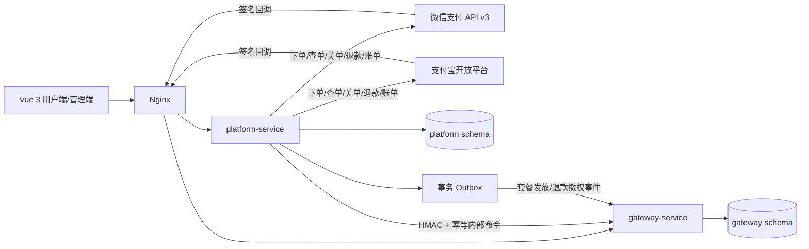
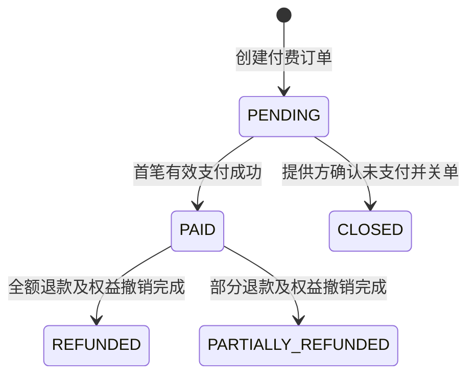
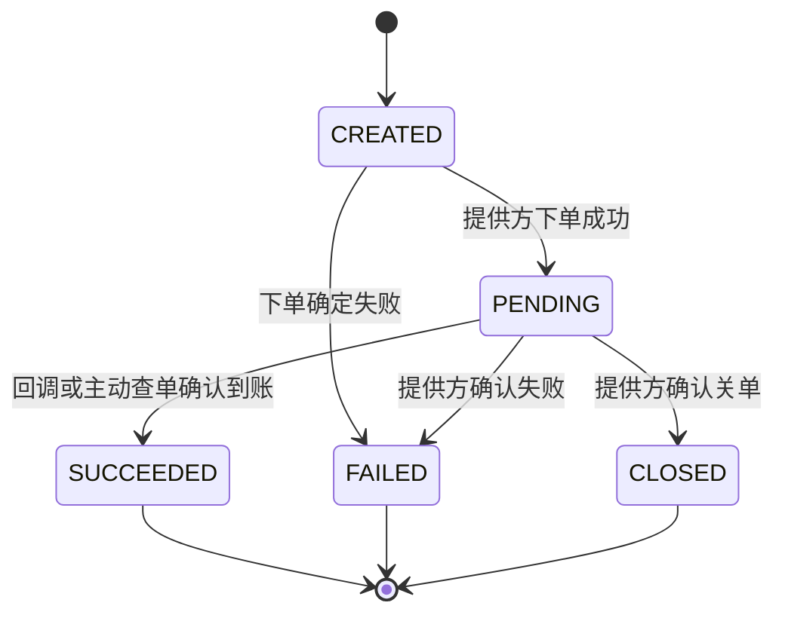
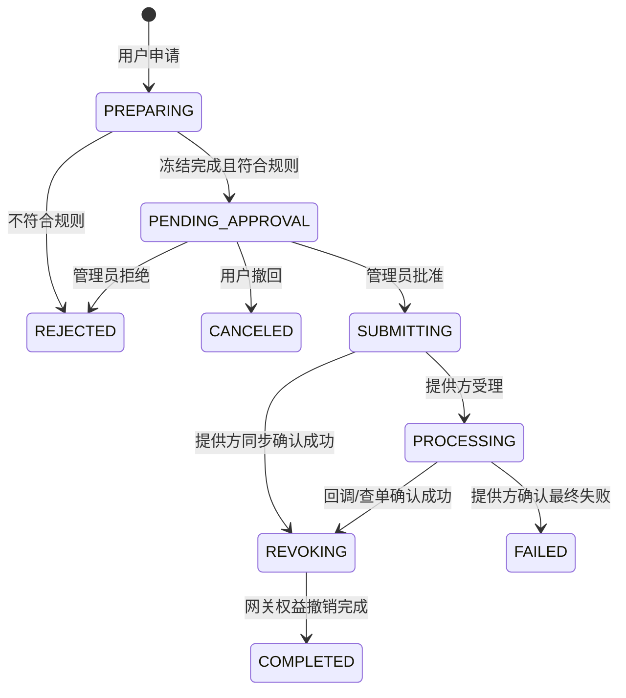

# API 模型服务平台二期商业交易闭环设计

> 状态：待确认
> 日期：2026-08-01
> 适用项目：`api-model-platform`
>
> **2026-09-24 变更说明**：本文第 29、491 行声明「只支持一次性购买，不做订阅、签约代扣或
> 自动续费」。该声明已被 [`2026-09-22-subscription-auto-renewal-design.md`](2026-09-22-subscription-auto-renewal-design.md)
> **部分取代**：Phase 1 已实现**钱包余额自动续费**（连续包月），**渠道侧签约代扣仍留在 Phase 2**。
> 本文其余内容不受影响。

## 1. 目标

在一期“双 Spring Boot 服务 + Vue 3 控制台”的基础上完成套餐商业交易闭环：用户领取免费版或购买已发布的付费套餐，使用微信支付或支付宝完成一次性付款，平台安全处理回调、查单、关单、退款、对账和站内状态通知，并继续通过事务 Outbox 将套餐权益发放或撤销到网关。

二期不新增第三个后端服务。支付、订单、退款和对账仍归属 `platform-service`；`gateway-service` 只扩展退款所需的套餐冻结、稳定用量快照和幂等撤销能力。

## 2. 需求优先级

发生冲突时按以下顺序执行：

1. 本轮对话中已确认的二期规则；
2. 一期实际交付代码及数据库约束；
3. 已确认的一期总体设计；
4. 原始需求 PDF。

因此，原始 PDF 中的余额充值、余额支付和支付后自动创建 API Key 不进入二期。继续保留一期由用户自行创建 API Key、完整密钥只显示一次的安全设计。

## 3. 已确认业务规则

### 3.1 套餐与购买

- 只使用套餐 Token 总量，不引入余额或按量后付费。
- 只支持一次性购买，不做订阅、签约代扣或自动续费。
- 同一用户只能有一个 `ACTIVE` 套餐，后续套餐按购买/发放顺序进入 `QUEUED`。
- 排队套餐从实际激活时开始计算有效期。
- 免费版由用户自助领取，每个账号仅一次，不创建支付订单。
- 入门级和高级通过在线支付购买。
- 企业定制级只有在管理员发布了明确 Token、价格和模型权限的固定版本后才能在线购买；未定价方案不可下单。
- 支付订单保存不可变的套餐与价格快照，之后的套餐调价只影响新订单。

### 3.2 支付产品

- 微信支付：桌面端使用 Native 扫码，普通移动浏览器使用 H5。
- 支付宝：桌面端使用电脑网站支付，移动浏览器使用 WAP。
- 二期不支持微信 JSAPI、小程序支付或需要 OpenID 的授权链路。
- 商户资料、正式回调域名和生产证书在上线前由客户提供；缺失时使用本地模拟渠道完成开发验收。

### 3.3 订单有效期与重试

- 待支付订单有效期为 15 分钟。
- 超时任务必须先向支付渠道查单，确认未支付后才能关闭本地订单。
- 支付失败或支付链接过期时可在原业务订单上重试，每次重试创建新的支付交易。
- 重试时可切换微信支付或支付宝。
- 已最终关闭的业务订单不可继续支付，用户必须重新创建订单。

### 3.4 退款

- 所有退款都由用户提交申请，并且必须经过管理员审核；不做自动退款。
- 系统自动校验资格并生成退款计算快照，不符合规则的申请不进入审核队列。
- 全额退款：支付成功后 7 天内且已消耗 Token 为 0，退回全部实付金额，不收手续费。
- 部分退款：已消耗 Token 大于 0 且不超过总 Token 的 10%，退款基数为 `实付金额 * 剩余 Token / 总 Token`。
- 部分退款手续费为实付金额的 5%，后台可配置，最低 1 元。
- 最终部分退款金额为 `退款基数 - 手续费`。
- 不可退款：已消耗 Token 超过 10%、套餐已过期，或支付成功已超过 7 天。
- 排队套餐的已消耗 Token 为 0，但退款期限仍从支付成功时间计算，不从激活时间计算。
- 部分退款成功后回收整个套餐剩余权益，不保留剩余 Token。
- 二期不做发票功能，因此不校验发票或红冲状态。

### 3.5 通知与发票

- 支付和退款通知仅在 Vue 控制台内展示。
- 用户可在收银台和订单中心看到支付、发放、排队、退款的最新状态。
- 管理员可看到回调验签失败、金额不一致、查单不确定、重复到账、对账差异和退款失败。
- 不接短信、邮件或微信模板消息。
- 不做发票申请、开具、下载、红冲、后台登记或税务平台对接。

## 4. 总体架构

### 4.1 `platform-service`

新增或重构以下边界：

- `OrderApplicationService`：免费领取、付费订单创建、15 分钟有效期和订单查询。
- `PaymentAttemptService`：创建支付尝试、重试、切换渠道和客户端支付动作。
- `PaymentPostingService`：提供方无关的支付成功入账、订单状态更新、套餐发放和审计事务。
- `PaymentAdapterRegistry`：按支付提供方和支付产品选择适配器。
- `WechatPayAdapter`、`AlipayAdapter`：只处理提供方协议，不直接修改平台业务表。
- `RefundApplicationService`：申请、资格校验、冻结、计算、管理员审核和退款编排。
- `ReconciliationService`：主动查单、关单、退款查询、日账单对账和差异处理。
- `PaymentAnomalyService`：记录和展示必须人工处理的支付异常。

### 4.2 `gateway-service`

新增最小退款边界：

- 按 `grant_request_id` 和退款业务号创建幂等退款冻结。
- 冻结后拒绝该套餐的新额度预占。
- 等待既有 `RESERVED` 请求结算或超时恢复后返回稳定用量快照。
- 退款被拒绝或取消时幂等释放冻结。
- 支付渠道退款成功后消费撤权事件，将套餐置为 `REVOKED`。
- 若撤销的是当前活动套餐，按现有规则激活最早的排队套餐并重新绑定可继续使用的 API Key。
- 不因套餐退款永久撤销用户的 API Key；API Key 是否可用继续取决于绑定套餐和允许模型。

## 5. 领域状态机

### 5.1 订单

支付失败不直接关闭业务订单。只要订单仍在 15 分钟内，或已有支付尝试允许安全重试，订单保持 `PENDING`。订单一旦 `PAID`，套餐版本、金额和用户归属不可修改。

### 5.2 支付交易

- 同一订单同一时间只允许一条 `CREATED/PENDING` 支付交易。
- 平台交易号在调用提供方前生成，并作为提供方商户订单号使用。
- 同一提供方交易号重放返回已有结果，不重复发放套餐。
- 第一笔成功且成功应用到订单的交易获得订单权益。罕见的第二笔真实到账只记录为重复到账异常，不再次发放，交由管理员退款处理。

### 5.3 退款

- `PREPARING` 开始即冻结对应套餐，防止用量继续变化。
- `REJECTED`、`CANCELED` 或最终 `FAILED` 必须释放冻结并恢复原套餐状态。
- 提供方结果不确定时保持 `PROCESSING` 并使用同一个退款号查询，不得重新生成退款号。
- 提供方已退款但网关暂时不可用时保持 `REVOKING`，Outbox 持续重试，不能恢复套餐使用。
- 只有权益撤销成功后退款才进入 `COMPLETED`，订单随后进入 `REFUNDED` 或 `PARTIALLY_REFUNDED`。

## 6. 数据库变更

所有修改使用新的 Flyway 版本，不修改一期迁移。

### 6.1 `customer_order`

保留一期表并增加：

- `expires_at`：待支付截止时间；
- `package_snapshot jsonb`：套餐代码、名称、版本、Token、有效期、模型权限和售价快照；
- `idempotency_key`：用户创建订单的幂等键，与用户 ID 建唯一约束；
- `successful_payment_transaction_id`：实际应用到订单的唯一成功交易；
- `closed_reason`、`lock_version`：关单原因和乐观锁版本。

现有 `payment_provider` 只作为兼容字段或最后选择展示，不再作为支付历史真相；每次尝试的提供方以 `payment_transaction.provider` 为准。

### 6.2 `payment_transaction`

增加：

- `payment_product`：`WECHAT_NATIVE`、`WECHAT_H5`、`ALIPAY_PAGE`、`ALIPAY_WAP`；
- `provider_status`、`provider_error_code`：脱敏后的提供方状态；
- `expires_at`、`last_queried_at`、`callback_received_at`；
- `applied_to_order`：是否为订单实际生效的成功交易；
- `request_payload_hash`、`callback_hash`：防止同号不同载荷；
- `lock_version`。

数据库约束：

- 同一订单最多一条活动支付交易；
- 同一订单最多一条 `applied_to_order = true` 的成功交易；
- `(provider, external_trade_no)` 保持唯一；
- 平台 `transaction_no` 保持全局唯一。

支付 URL、二维码内容或跳转表单只在有效期内返回前端，不写日志。确需恢复收银台时加密保存最小客户端动作，并在交易关闭后清理。

### 6.3 `refund`

扩展现有表：

- 状态改为本设计退款状态机；
- `refund_type`：`FULL` 或 `PARTIAL`；
- `policy_version`、`calculation_snapshot jsonb`；
- `requested_by`、`reviewed_by`、`reviewed_at`、`review_note`；
- `provider`、`provider_status`、`provider_error_code`；
- `gateway_hold_business_no`、`revocation_business_no`；
- `submitted_at`、`completed_at`、`lock_version`。

同一订单只允许一个未终态退款。退款失败后的重试复用原 `refund_no`，不创建第二个退款业务号。

### 6.4 新表

- `refund_policy_version`：手续费基点、最低手续费、退款窗口、最大消耗比例、生效时间和发布状态。
- `payment_anomaly`：异常类型、订单/交易/退款、脱敏详情、处理状态、负责人和处理时间。
- `reconciliation_run`：提供方、账单日期、运行状态、统计和文件摘要。
- `reconciliation_item`：平台记录与提供方记录的匹配结果、差异类型和处置状态。

### 6.5 网关迁移

- 新增 `package_refund_hold`，记录业务号、套餐实例、原状态、冻结状态、用量快照和重放哈希。
- 扩展套餐生命周期审计或额度流水，记录退款撤权事件，但不伪造 Token 消耗。
- 保留 `REVOKED` 套餐状态；撤权前通过退款冻结阻止新额度预占。
- 增加按套餐和状态查询未完成 reservation 的索引。

## 7. 金额与退款计算

金额统一使用人民币分和 Java `long`，禁止 `double/float`。

设：

- `paid`：实付金额，单位分；
- `total`：套餐总 Token；
- `used`：冻结后稳定的已消耗 Token；
- `remaining = total - used`；
- `feeBps`：手续费基点，5% 为 500；
- `minimumFee`：最低手续费，默认 100 分。

规则：

1. `used == 0`：`refundAmount = paid`，`fee = 0`。
2. 用整数交叉乘法判断 `used / total <= 10%`，避免浮点误差。
3. `baseRefund = floor(paid * remaining / total)`。
4. `fee = max(minimumFee, roundHalfUp(paid * feeBps / 10000))`。
5. `refundAmount = max(0, baseRefund - fee)`。

乘法使用 `Math.multiplyExact`、`BigInteger` 或等价的安全实现防止溢出。计算快照永久保存输入值、舍入方式、结果、策略版本和计算时间，管理员不能手改系统计算结果；如需特殊处理，必须拒绝原申请并通过独立、可审计的异常流程处理。

退款时间窗口采用 `requestTime <= paidAt + 7 days`。退款准备阶段再次检查套餐没有过期。

## 8. 核心调用流程

### 8.1 免费版领取

1. 用户在套餐页点击领取免费版。
2. `platform-service` 以用户身份和免费套餐版本生成稳定业务号。
3. 数据库唯一约束和网关 `once_per_user` 双重防重复。
4. 创建 `SYSTEM` 来源的发放请求和 Outbox。
5. 网关按现有规则激活或排队。

### 8.2 付费购买

1. 用户选择已发布且价格大于 0 的套餐版本。
2. 订单服务校验用户、套餐状态、固定售价和购买幂等键，创建 15 分钟订单快照。
3. 用户选择支付方式，支付尝试服务关闭或确认不存在旧的活动尝试。
4. 适配器使用平台交易号向提供方下单，返回二维码、H5 URL 或支付宝跳转动作。
5. 前端展示支付动作并轮询平台订单详情。
6. 回调或主动查单确认支付成功后，统一入账服务锁定订单和提供方交易号。
7. 在一个平台数据库事务中写支付成功、订单 `PAID`、`ORDER` 发放请求、套餐快照 Outbox 和审计日志。
8. 网关消费发放事件并返回 `ACTIVE` 或 `QUEUED`，前端展示最终权益状态。

### 8.3 退款

1. 用户对已支付订单提交退款申请。
2. 平台进行基础校验并请求网关建立退款冻结。
3. 网关拒绝新预占，等待既有请求结算或恢复，返回签名保护的稳定 Token 快照。
4. 平台按策略计算金额；不符合规则则拒绝并释放冻结。
5. 符合规则则进入管理员审核，冻结期间套餐不可继续调用。
6. 管理员拒绝或用户审核前撤回时释放冻结。
7. 管理员批准后使用原支付提供方和唯一退款号发起退款。
8. 提供方成功后，平台事务写退款结果和 `PACKAGE_REFUNDED_V1` Outbox。
9. 网关幂等撤销套餐；若原套餐为活动套餐，则激活下一排队套餐并重绑 API Key。
10. Outbox 投递成功后平台将退款置为 `COMPLETED`，更新订单状态并展示站内结果。

## 9. 支付适配器

重构 `PaymentAdapter`，提供以下能力：

- `createPayment`：生成支付动作；
- `verifyAndParseCallback`：基于原始请求体和完整签名头验签并解析；
- `queryPayment`：主动查询支付状态；
- `closePayment`：关闭未支付交易；
- `createRefund`：使用唯一退款号发起退款；
- `queryRefund`：解决异步或不确定退款结果；
- `downloadBill`：获取日账单或对账数据。

适配器返回统一的 Java 类型状态，不抛出包含密钥、完整请求或敏感响应的异常。业务服务不得解析微信/支付宝专有字段。

实现优先使用官方 Java SDK；若某能力必须调用原生 HTTP，则统一使用有连接、读取和总时限的 Java HTTP 客户端，并独立实现签名契约测试。

## 10. API 设计

### 10.1 用户接口

- `POST /console/platform/plans/free/claim`：免费版幂等领取。
- `POST /console/platform/orders`：创建付费订单，要求 `Idempotency-Key`。
- `GET /console/platform/orders/{orderNo}`：订单、最新支付尝试、发放和退款状态。
- `POST /console/platform/orders/{orderNo}/payment-attempts`：选择提供方和产品并创建/重试支付。
- `POST /console/platform/orders/{orderNo}/close`：用户主动关闭，仍需提供方确认。
- `POST /console/platform/orders/{orderNo}/refunds`：提交退款申请。
- `POST /console/platform/refunds/{refundNo}/cancel`：管理员审核前撤回。
- `GET /console/platform/refunds/{refundNo}`：查看退款进度和计算摘要。

### 10.2 公开支付回调

- `POST /console/platform/payments/wechat-pay/callback`
- `POST /console/platform/payments/alipay/callback`

回调接口不依赖用户 JWT，只接受提供方签名认证。路径仅精确放行，不放行整个支付目录。

### 10.3 管理员接口

- 订单、支付、退款列表增加详情、状态和异常筛选。
- `POST /console/platform/admin/refunds/{refundNo}/approve`
- `POST /console/platform/admin/refunds/{refundNo}/reject`
- `GET /console/platform/admin/payment-anomalies`
- `PATCH /console/platform/admin/payment-anomalies/{id}`
- `POST /console/platform/admin/reconciliation-runs`
- `GET /console/platform/admin/reconciliation-runs/{id}`
- 支付配置接口只管理启停和可用性状态，不通过浏览器读取或回传私钥。

### 10.4 内部接口与事件

- `POST /internal/refunds/prepare`：建立冻结并返回 `WAITING` 或稳定用量快照。
- `POST /internal/refunds/release`：拒绝、取消或最终失败时释放冻结。
- `POST /internal/events/package-refunded`：消费撤权 Outbox 事件。

内部请求使用时间戳、请求 ID、正文 SHA-256 和 HMAC 签名；业务号、事件 ID 和载荷哈希同时做数据库幂等，避免同号不同载荷。

## 11. 定时任务与对账

继续使用数据库任务和 `FOR UPDATE SKIP LOCKED`，不引入 Kafka/RabbitMQ。

- 订单到期任务：小批量领取到期订单，查询提供方后关单。
- 支付补偿任务：轮询长时间 `PENDING` 或回调缺失的支付尝试。
- 退款补偿任务：查询 `PROCESSING` 或调用结果不确定的退款。
- 退款准备任务：等待网关既有 reservation 结束并获取稳定快照。
- Outbox 任务：投递套餐发放和退款撤权事件。
- 日对账任务：按提供方和账单日期下载账单，逐条匹配并生成差异项。

任务必须具备租约/领取令牌、最大尝试次数、指数退避、单批上限和人工重试。多实例运行时同一记录只能被一个任务持有。

对账至少识别：

- 提供方成功、平台未入账；
- 平台成功、提供方无记录或金额不一致；
- 重复到账；
- 退款状态或金额不一致；
- 已关闭订单晚到支付；
- 账单记录无法关联平台交易号。

对账只自动修复能通过提供方签名/查询确认且幂等安全的状态；金额差异和重复到账进入人工异常队列。

## 12. 安全设计

- 微信/支付宝回调必须先验签，再解析和修改业务数据。
- 微信回调执行证书/平台公钥校验、时间窗口校验和 APIv3 报文解密。
- 支付宝使用支付宝公钥验证原始参数签名，并校验 `app_id`、卖家身份、金额、币种和商户订单号。
- 回调按提供方事件号、外部交易号、平台交易号和载荷哈希防重放。
- 支付私钥、APIv3 key 和证书由部署 Secret、Secret 文件或生产密钥系统注入，不通过 Vue 页面维护。
- `payment_config` 只保存非敏感启停、环境、凭据指纹和最近验证状态；现有加密字段不通过管理接口暴露。
- 提供方原始回调、二维码、跳转表单和完整账单不写应用日志。
- 审计日志只保存订单号、交易号、退款号、状态、金额、操作者和脱敏错误分类。
- 管理员批准退款、拒绝退款、切换支付配置、处理异常和手工启动对账都写审计。
- 生产环境必须启用 HTTPS、Secure Cookie、可信反向代理配置和准确系统时钟。

## 13. Vue 3 用户体验

### 13.1 套餐页

- 免费版显示一次性领取动作及已领取状态。
- 付费套餐显示购买动作；未发布、未定价或不可购买版本禁用动作。
- 当前和排队套餐状态继续与一期额度摘要合并展示。

### 13.2 收银台

- 订单摘要固定展示套餐、Token、有效期、实付金额和 15 分钟倒计时。
- 使用分段控件选择微信或支付宝，并按设备选择对应支付产品。
- 微信 Native 显示二维码；H5/WAP/电脑网站支付使用明确的跳转动作。
- 页面轮询平台订单状态，不能把客户端跳转结果当作支付成功依据。
- 支付失败可重新生成尝试；订单关闭后引导创建新订单。
- 支付成功展示套餐为 `ACTIVE` 或 `QUEUED`，不自动创建 API Key。

### 13.3 订单与退款

- 订单列表增加详情入口和中文状态文本。
- 订单详情展示每次支付尝试、到账时间、套餐发放状态和退款进度。
- 符合基础条件时显示退款申请；提交前展示规则和预计冻结影响。
- 退款计算完成后展示总额、已用 Token、剩余 Token、手续费和预计退款金额。
- 审核前允许撤回，管理员批准后不再允许撤回。

### 13.4 管理端

- 订单、支付、退款改为标签页或主从详情，不在一张超宽表中堆叠所有操作。
- 退款审核对话框展示不可编辑的计算快照和风险信息。
- 异常队列支持类型、状态、提供方、时间和订单号筛选。
- 对账页展示运行批次、匹配统计、差异项和处置状态。
- 支付配置页只展示环境、启用状态、凭据是否就绪、证书/公钥指纹和最近验证时间。

## 14. 故障与一致性

- 平台数据库事务是订单、支付入账、发放请求和 Outbox 的本地原子边界。
- 任何支付回调重放均返回已有业务结果，不重复创建发放或撤权事件。
- 提供方调用超时视为结果不确定，不直接标记失败；使用相同业务号主动查询。
- 网关不可用时支付可先可靠入账并由 Outbox 延迟发放；退款准备不能绕过网关稳定快照。
- 提供方退款成功后即使网关暂时不可用，也保持套餐冻结并重试撤权，不恢复使用。
- PostgreSQL 不可用时拒绝创建订单、入账、退款和审核。
- Redis 不参与支付和退款的最终一致性，不能作为订单状态真相。
- 关单、回调、查单入账和支付重试在订单锁下串行化。
- 冻结、结算、撤权和排队激活在网关用户/套餐锁下串行化。

## 15. 可观测性

指标至少包括：

- 订单创建数、支付成功率、支付耗时和渠道占比；
- 回调验签失败、重复回调、金额不一致和重复到账；
- 到期订单、查单延迟和关单失败；
- 退款申请、审核时长、退款成功率和退款金额；
- 退款冻结等待时长和撤权 Outbox 延迟；
- 对账差异数量、未处理时长和按提供方分布。

结构化日志通过 `traceId`、`orderNo`、`transactionNo`、`refundNo` 和 `businessNo` 关联，禁止写入密钥、完整回调、付款 URL 或用户文件内容。

## 16. 测试与验收

### 16.1 单元与数据库集成测试

- 退款 0%、恰好 10%、超过 10%、7 天边界、过期、最低手续费和分舍入。
- 创建订单、创建支付尝试、回调、查单、关单和退款的顺序与并发幂等。
- 同一外部交易号跨订单冲突、同一订单重复回调、两个渠道竞态到账。
- Outbox 写入失败时支付入账整体回滚。
- 退款冻结期间拒绝新预占，已有 reservation 结算后快照稳定。
- 撤销活动/排队套餐、激活下一套餐和 API Key 重绑只发生一次。
- 管理员审核权限、审计内容和敏感字段脱敏。

### 16.2 提供方契约测试

- 使用 WireMock 或等价本地模拟覆盖下单、二维码/跳转、成功/失败回调、验签失败、查单、关单、退款和账单。
- 覆盖超时、5xx、响应格式错误、证书/公钥轮换和同号不同载荷。
- 本地 Compose 绝不连接真实生产支付或消耗真实资金。

### 16.3 Vue 与 E2E

- 免费领取、微信二维码、移动支付跳转、支付宝跳转、支付重试和订单超时。
- 支付成功后 `ACTIVE/QUEUED` 展示和订单详情。
- 退款申请、管理员审核、拒绝/撤回、提供方处理和最终撤权。
- 回调丢失后的主动查单、重复到账异常和对账差异处理。
- 桌面 `1440x900`、移动 `390x844` 和 `360x800` 无重叠、裁切或横向溢出。

### 16.4 上线门禁

- 微信和支付宝沙箱/测试环境完成真实签名、验签、查单、关单和退款验证。
- 正式回调域名使用 HTTPS 且从公网可达，只暴露精确回调路径。
- 正式商户身份、金额和到账账户经过人工双人核对。
- 生产密钥、证书、APIv3 key、支付宝公钥和轮换手册齐备。
- 生产支付默认关闭，完成配置和冒烟测试后由管理员显式启用。
- 一期完整 Maven、Vitest、Vue build、Compose 和 Playwright 回归继续通过。

## 17. 性能边界

二期不得降低一期已记录的总体性能目标：普通查询不低于 100 RPS、登录/订单接口不低于 30 TPS、平台新增延迟 P95 不超过 200 ms、普通接口响应 P95 不超过 500 ms、平台内部请求成功率不低于 99.5%。

支付提供方网络耗时单独统计，不计入平台本地处理延迟。回调和定时任务使用小批次、索引和 `SKIP LOCKED`，不能占满 Spring MVC 请求线程或数据库连接池。

## 18. 明确不做

- 余额、充值、按量后付费；
- 自动续费、订阅、签约代扣；
- 微信 JSAPI、小程序支付；
- 发票和税务平台；
- 短信、邮件、微信模板消息；
- 自动退款；
- 第三个支付微服务；
- Kafka 或 RabbitMQ；
- 支付成功后自动创建 API Key；
- 未发布或未确定价格的企业定制方案在线下单。

## 19. 上线前外部资料

以下信息不阻塞本地开发，但阻塞真实沙箱/生产验收：

- 微信支付 AppID、商户号、商户私钥、APIv3 key、证书序列号、微信支付平台公钥及公钥 ID；
- 支付宝 AppID、应用私钥和支付宝公钥；
- 沙箱账号、商户后台权限和测试资金安排；
- 公网 HTTPS 域名、微信和支付宝回调 URL；
- 生产密钥保管人、证书轮换负责人和支付异常联系人；
- 实际商户主体、收款账户、支付费率及退款到账规则。

在这些资料缺失时，所有真实适配器保持关闭，本地只使用模拟渠道和管理员可审计的测试流程。

## 20. 完成定义

二期完成必须同时满足：

1. 免费版可幂等自助领取一次；
2. 已发布付费套餐可通过四种已确认支付产品完成一次性购买；
3. 回调、查单、关单和支付重试在并发与重放下不重复入账或发放；
4. 15 分钟到期订单经提供方确认后正确关闭；
5. 退款规则、管理员审核、提供方退款和套餐撤权形成闭环；
6. 日对账能发现并展示支付与退款差异；
7. 用户端和管理端完整覆盖订单、支付、退款和异常状态；
8. 本地模拟验收、提供方沙箱验收、全量回归和安全检查全部通过；
9. 未提供生产资料时真实支付保持不可启用；
10. README 和运维手册准确描述配置、轮换、对账、异常和回滚流程。
